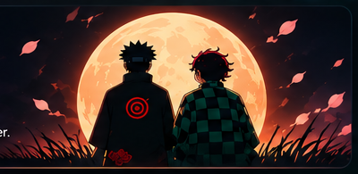

---

<table>
<tr>
<td width="62%" valign="top">

## 👋 Hi, I'm Mukesh Kumar!

**Android Developer · Mobile Engineer · Anime Enthusiast**

A developer who loves building scalable, real-world applications, solving complex problems, and exploring new technologies — with the persistence of a Shinobi and the discipline of a Demon Slayer.

### 🥷 About Me

- 🔭 Working as an Android developer with **MVI, Clean Architecture, MVVM, MVP and MVC**.
- 👯 Looking to collaborate on **Android, SwiftUI and Node.js** projects.
- 🤝 Interested in **backend optimization with Node.js**.
- 🌱 Currently learning **SwiftUI, Angular and Node.js**.
- 💬 Ask me about **Android architectures, design patterns and Kotlin**.
- ⚡ I love exploring new tech and building efficient solutions.

</td>
<td width="38%" valign="top">

## 🎯 Currently Focused On

- ✅ Android & Clean Architecture
- ✅ SwiftUI & iOS Development
- 🌱 Angular & Node.js
- 🌱 Backend Optimization
- 🌱 Scalable Applications

</td>
</tr>
</table>

## ⚔️ Tech Stack — My Jutsu

<table>
<tr>
<td width="50%" valign="top">

### 📱 Mobile Development

**Also working with:** Kotlin Multiplatform, Compose Multiplatform, SwiftUI, React Native.

### 🧩 Backend

**Also:** Ktor, Apollo GraphQL.

### 🗄️ Database

</td>
<td width="50%" valign="top">

### 🌐 Frontend

### ☁️ DevOps

### 🛠️ Tools & Design

**Also:** SonarQube, Swagger, npm, Nodemon, Socket.IO, Apache Tomcat, JWT.

</td>
</tr>
</table>

## 🌐 Connect With Me

## 🧠 Coding Profiles

## 📊 Shinobi Records — GitHub Stats

## 🌊 Contribution Activity

<!-- Generated automatically by .github/workflows/profile-3d.yml -->

---

### 🍃 One mission. One commit. Continuous improvement.

**Thanks for visiting my profile!**

